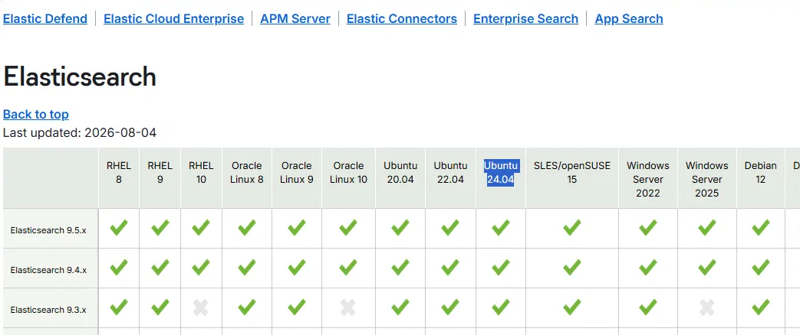
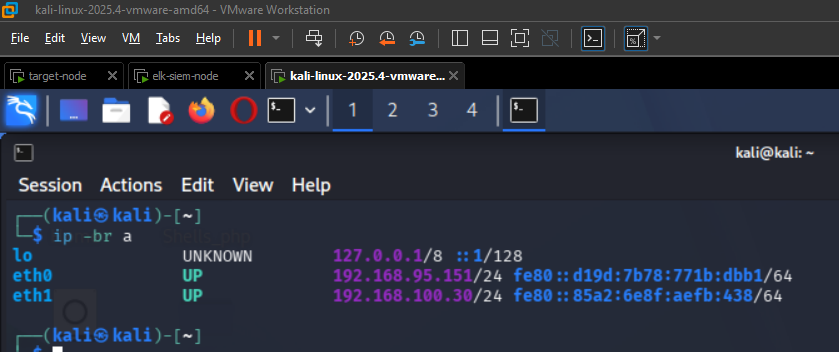
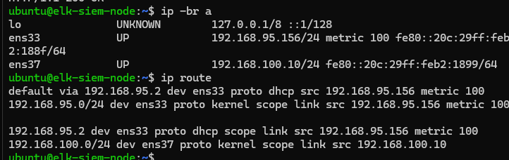
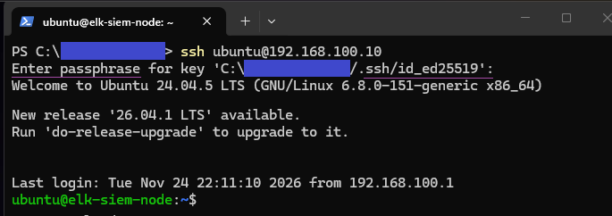
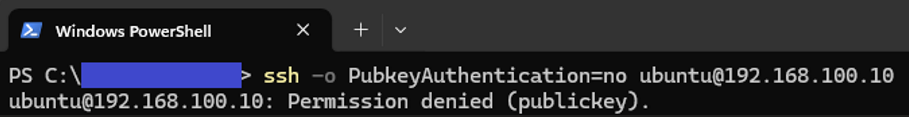
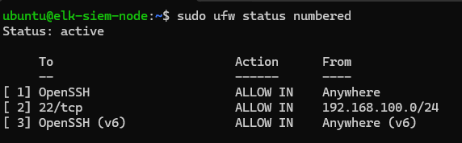
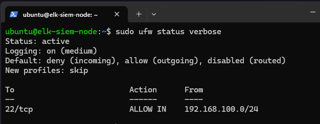
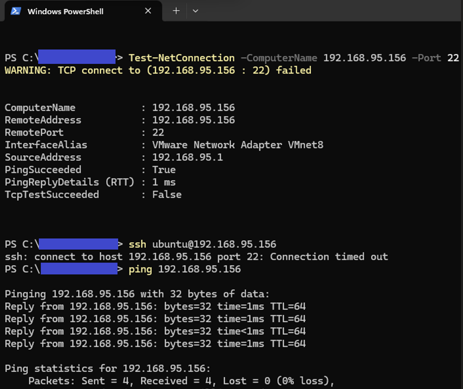

# Elastic SIEM Lab

I built this lab to learn Elastic Security hands-on. I have studied SIEM concepts during my cyber security bachelor and in the Google Cybersecurity Professional Certificate, but I had never worked with the Elastic before. The goal here is to get comfortable with how Elastic does it: how logs get from a host into Elasticsearch, how Fleet manages the agents, and how detection rules are written and tested in Kibana. Everything runs inside VMware.

The setup is small: one Elastic Stack server, one Linux host that gets monitored, one Kali VM that attacks it, and the detection rules I write to catch those attacks.

This repository documents what I did, why I did it, and what went wrong along the way. I kept the commands and the screenshots so the results can be checked.

## Why I built it

I wanted hands-on experience with Elastic Security, because many job postings name it and reading the documentation is not the same as running the stack. I also wanted to see how a log gets from a host into Elasticsearch, and why a detection can fail even when the rule looks correct in Kibana. Network segmentation came later, as a second track. I wanted Elastic working before I started changing firewall rules, so I would know which part caused a problem.

## Tools and versions

- Windows host running VMware Workstation Pro.
- Ubuntu Server 24.04 LTS for the Elastic server and the monitored host.
- Kali Linux VM as the attacker.
- Elastic Stack 9.5.3 (Elasticsearch, Kibana, Fleet Server, Elastic Agent), the version that was current when I started.

The host has 100 GB of RAM, which is far more than this lab needs. The VM sizes below are what I chose, not the minimum. I have not tried smaller sizes, so I cannot say how low they can go.

## Terms used in this README

**SIEM (Security Information and Event Management):** a system that collects logs from many machines, stores them in one place, and runs rules that flag suspicious activity.

**Elasticsearch:** the search and storage engine that holds the logs.

**Kibana:** the web interface where I search logs, view dashboards, and manage detection rules.

**Fleet Server:** the component that manages Elastic Agents from one central place.

**Elastic Agent:** a small program installed on each monitored host. It collects logs and sends them to Elasticsearch through Fleet.

**Integration:** a ready-made package that tells the agent which logs to collect and how to read them.

**Data stream:** how Elasticsearch stores time-based logs, so they can be searched and kept according to a retention policy.

**Detection rule:** a condition that runs over incoming events and creates an alert when it matches.

**ECS (Elastic Common Schema):** the standard field names Elastic uses, for example `source.ip` or `user.name`. Rules are easier to write when every log source uses the same names.

**MITRE ATT&CK:** a public catalogue of attacker techniques. Each detection in this lab is linked to one or more of them.

## Lab design

### Why two tracks

The first track is the SIEM on a flat network. I wanted the SIEM to work before I added firewall rules, so that a broken log pipeline could only be caused by the SIEM setup. The second track is segmentation, which I added after logs were already flowing. That way each firewall rule could be tested against real data.

### Track 1: flat lab network

| VM | IP on lab-net | RAM | vCPU | Disk | Role |
|---|---|---|---|---|---|
| Windows host | 192.168.100.1 | (host) | (host) | (host) | Browser for Kibana, SSH client to make my life easyer |
| `elk-siem-node` | 192.168.100.10 | 16 GB | 4 | 80 GB | Elasticsearch, Kibana, Fleet Server |
| `target-node` | 192.168.100.20 | 4 GB | 2 | 30 GB | Monitored host, DVWA in Docker, Elastic Agent |
| `kali` | 192.168.100.30 | 8 GB | 2 | existing | Attacker |

All lab VMs sit on one host-only network called `lab-net`, `192.168.100.0/24`. The Windows host has `.1` on this network, so I can open Kibana in the browser and SSH into each VM from PowerShell or VS Code without switching windows. Keeping the lab reachable from the host was a practical choice for working faster, not a security decision.

Each VM also has a second adapter on NAT. I use it only for package updates. Attack traffic never goes through it, so it does not change what the lab tests.

### Track 2: segmentation (chapter 11)

Companies rarely run everything on one network, and firewall logs are among the most useful sources a security team has. In this track I add a fourth VM, `fw-node`, as a router and firewall running nftables. It splits the lab into four zones with default deny between them, and its logs go to the same SIEM.

| Zone | Network | Hosts |
|---|---|---|
| mgmt | 10.10.10.0/24 | Windows host, fw-node |
| attack | 10.10.20.0/24 | kali |
| dmz | 10.10.30.0/24 | target-node |
| security | 10.10.40.0/24 | elk-siem-node |

The rules I plan to allow are these. The Windows host reaches every zone over SSH, and Kibana in the security zone. The attack zone reaches the dmz zone, since that is where the attacks land. The dmz zone reaches Fleet and Elasticsearch in the security zone, on those ports only, because agents start the connection. The attack zone has no path to the security zone. I want to confirm that with a test from Kali, not just assume it.

## Phases

- [X] Phase 0: Design
- [X] Phase 1: Virtual machines and flat network
- [X] Phase 2: Base hardening
- [ ] Phase 3: Elasticsearch and Kibana
- [ ] Phase 4: Fleet Server and Elastic Agent
- [ ] Phase 5: Baseline data collection
- [ ] Phase 6: DVWA target
- [ ] Phase 7: Attack simulation from Kali
- [ ] Phase 8: Detection rules, tested against the attacks
- [ ] Phase 9: Dashboard and alerting
- [ ] Phase 10: Summary and lessons learned
- [ ] Phase 11: Segmentation with fw-node

## Implementation log

Each phase below follows the same pattern. First what I did, then why, then the commands, then the output I got, and last the problems I ran into and how I solved them. Screenshots only appear where they show something I want to prove.


### Phase 1: Lab network and virtual machines

#### Background
Phase 0 set the plan: a flat network first, so the SIEM can be checked before any firewall rules are added. This phase builds the network and the three VMs the rest of the lab depends on. Nothing from Elastic is installed yet.


#### 1. Choosing Ubuntu Server 24.04
Before creating any VM I checked the Elastic support matrix for version 9.5.3. A wrong OS choice will be hard to fix after, so this was the first thing I looked at. Ubuntu 24.04 is listed as supported.
https://www.elastic.co/support/matrix 




#### 2. Creating the lab network
In VMware Workstation I opened **Edit > Virtual Network Editor** and clicked **Change Settings**, because the editor needs administrator rights. I selected VMnet2 and set it to Host-only. I unticked "Use local DHCP service to distribute IP addresses to VMs", set the subnet to `192.168.100.0` with mask `255.255.255.0`, and applied the change.

I turned DHCP off on purpose. If VMware hands out addresses, they can change, and then the addresses in this README and in later firewall rules would be wrong. Fixed addresses make every later step easier to check.


The Windows host gets `192.168.100.1` on this network through its VMware adapter. I check that from PowerShell in step 8.


#### 3. Creating target-node
I created `target-node` the same way as the other VMs: Ubuntu Server 24.04 LTS, user `ubuntu`, 2 vCPU, 4 GB RAM, 30 GB disk. I ticked **Install OpenSSH server** during installation, so I could SSH in from PowerShell instead of working in the VMware console.


#### 4. Two network adapters on each VM
`elk-siem-node`, `target-node` and `kali` each have two adapters:

- **Adapter 1:** Custom, VMnet2 (lab-net). Lab traffic only.
- **Adapter 2:** NAT. Package updates only.

I added them under **VM Settings > Add > Network Adapter** with the VM powered off. Lab-net is the first adapter, so its interface name is predictable. NAT is second, so the default route stays on it. I check that in step 8.

Why keep NAT at all? Without it the VMs cannot reach the Ubuntu and Elastic package repositories. Lab-net has no gateway configured, so the default route stays on NAT. I also do not want attack traffic to have a way out of the lab, which is why lab-net is the only route for `192.168.100.0/24`, and why Kali gets `never-default` on lab-net (step 7).


#### 5. Stopping cloud-init from rewriting the network
Ubuntu Server uses cloud-init, and cloud-init rebuilds the network config at boot. That would wipe my static addresses on the next reboot. On both Ubuntu VMs I created a file that tells cloud-init to leave networking alone:


```bash
sudo nano /etc/cloud/cloud.cfg.d/99-disable-network-config.cfg
```

The file contains one line:

```yaml
network: {config: disabled}
```

Then I removed the netplan file cloud-init had generated, after my own file was in place:

```bash
sudo rm /etc/netplan/50-cloud-init.yaml
ls /etc/netplan/
```

Only `99-lab.yaml` are now remains.

#### 6. Static addresses with netplan
First I checked which interface name belongs to which adapter:

```bash
ip -br a
```

On my VMs, `ens33` is the NAT adapter and `ens37` is lab-net adapter. The giveaway was that the NAT adapter had already received an IP address via DHCP, while the other adapter was empty (no IP address assigned). Names can differ between hypervisor versions, so check your own output before copying anything from me.

I edited the network config over SSH. That worked because my SSH session ran over the NAT address, which did not change. If I had connected over lab-net, changing the lab-net address would have dropped the session in the middle of the change.

On `elk-siem-node` the file is `/etc/netplan/99-lab.yaml`:


```yaml
network:
  version: 2
  ethernets:
    ens33:
      dhcp4: true
    ens37:
      dhcp4: false
      addresses:
        - 192.168.100.10/24
```

On `target-node` the file is the same, with `192.168.100.20/24` on ens37.

Netplan reads indentation strictly, so I used two spaces per level and no tabs. I restricted the file permissions and tested before applying:


```bash
sudo chmod 600 /etc/netplan/99-lab.yaml
sudo netplan try
```

`netplan try` applies the new config for a short time and waits for confirmation. If access is lost, it rolls back by itself. I used `try` and not `apply` the first time for that reason.


#### 7. Kali on lab-net
Kali uses NetworkManager, so I set the static address with `nmcli`. First I found the interface:

```bash
nmcli device status
```

Kali has `eth0` for NAT and `eth1` for lab-net. Then I created a connection named `lab-net`:

```bash
sudo nmcli con add type ethernet ifname eth1 con-name lab-net \
  ipv4.method manual ipv4.addresses 192.168.100.30/24 \
  ipv4.never-default yes
sudo nmcli con up lab-net
```

`ipv4.never-default yes` is the setting that matters here. Without it, NetworkManager can pick lab-net as the default route, and then internet access stops or traffic leaves by the wrong interface. With it, lab-net only handles `192.168.100.0/24`.



#### 8. Verification
Interfaces from `ip -br a`:

| VM | Interface | Role | State | Address |
|---|---|---|---|---|
| target-node | ens33 | NAT | UP | 192.168.95.155/24 |
| target-node | ens37 | lab-net | UP | 192.168.100.20/24 |
| elk-siem-node | ens33 | NAT | UP | 192.168.95.156/24 |
| elk-siem-node | ens37 | lab-net | UP | 192.168.100.10/24 |
| kali | eth0 | NAT | UP | 192.168.95.151/24 |
| kali | eth1 | lab-net | UP | 192.168.100.30/24 |

The routing table on `target-node` after the change:

```
default via 192.168.95.2 dev ens33 proto dhcp src 192.168.95.155 metric 100
192.168.95.0/24 dev ens33 proto kernel scope link src 192.168.95.155 metric 100
192.168.100.0/24 dev ens37 proto kernel scope link src 192.168.100.20
```

The default route goes out through NAT, and the lab network goes out through lab-net. `elk-siem-node` shows the same pattern with its own addresses.



From each Ubuntu VM I pinged the other two lab addresses, and every ping got a reply with 0% packet loss. `curl` to the Ubuntu archive returned `HTTP/1.1 200 OK`, so NAT works for updates.

From the Windows host in PowerShell, all three lab addresses answered. SSH logged in to `target-node` and `elk-siem-node` without switching windows.


Reboot test: after a reboot the addresses stayed the same: `ens37 UP 192.168.100.10/24`
Reboot test: after a reboot, `elk-siem-node` still had `ens37` UP on `192.168.100.10/24`. and `target-node` `192.168.100.20/24`.


#### 9. Result and assessment
- **Result:** All three VMs are on lab-net with fixed addresses. They reach each other and the Windows host, and they still reach the internet through NAT.
- **Assessment:** The network works, but it is flat, which is what I wanted for now. Any VM can reach any other VM on lab-net. That is fine for phases 2 to 10, and it is exactly what chapter 11 will change.
- **Problems I hit:** None that blocked the phase.

Phase 2 is base hardening on the two Ubuntu VMs, before Elasticsearch is installed.


_________________


### Phase 2: Base hardening

#### Background
Phase 1 gave me two Ubuntu VMs on lab-net: `elk-siem-node` at 192.168.100.10 and `target-node` at 192.168.100.20. Both will run services, and both will be targets later. Before I install Elasticsearch, I want both hosts to start from the same baseline: current packages, key-based SSH only, a firewall that blocks inbound traffic by default, and clocks in UTC.

I did not harden Kali or the Windows host. Kali is the attacker, and the Windows host is only where I work from.

#### 1. Updating the packages
```bash
sudo apt update && sudo apt upgrade -y
cat /var/run/reboot-required 2>/dev/null
```

`sudo` runs a command as root, because the command changes system files. `apt update` downloads the current package list from the Ubuntu archive. It does not install anything. `apt upgrade -y` installs newer versions of the packages already on the machine. `-y` answers yes to the confirmation prompt. The `&&` between the two means the upgrade only runs if the update succeeded.

The second command reads a file that the system creates only when an update needs a reboot, usually a new kernel. If the file does not exist, `cat` would print an error. `2>/dev/null` sends that error to `/dev/null`, a special file that discards everything written to it. So a silent result means no reboot is needed.
I ran this first so both hosts were current before I changed how I log in. 


#### 2. Time zone
```bash
sudo timedatectl set-timezone UTC
timedatectl
```

`timedatectl` manages the clock and time zone through systemd. `set-timezone UTC` sets Coordinated Universal Time, which has no daylight saving changes. The second command shows the state. I look for three lines: `Time zone: UTC`, `System clock synchronized: yes`, and `NTP service: active`. The last two mean the clock is being kept in sync with a time server.

I use UTC because Elasticsearch stores timestamps in UTC, and logs from different hosts need to sort correctly. If one host used local time and another used UTC, the same event could look like it happened twice, or in the wrong order. Kibana shows times in the browser's time zone, so I still read local time in the interface.

Result on both VMs: `Time zone: UTC (UTC, +0000)`, `System clock synchronized: yes`, `NTP service: active`.


#### 3. SSH keys
I created the key on the Windows host, in PowerShell:

```powershell
ssh-keygen -t ed25519 -C "lab-admin"
type $HOME\.ssh\id_ed25519.pub
```

`ssh-keygen` creates a pair of keys: a private key and a public key. `-t ed25519` selects the algorithm. Ed25519 produces short keys with strong security, and it is the current default recommendation over older RSA keys. `-C "lab-admin"` adds a comment to the public key so I can recognise it later.

I accepted the default path, and entered a passphrase of my chose. The passphrase encrypts the private key on disk. If someone copies the file, they still need the passphrase to use it. Without one, the file works like a password to everything it opens.

The private key stays on the Windows host. The `.pub` file is the one that goes on the servers. `type` prints it to the screen, and I copied the single line that starts with `ssh-ed25519`.

On each Ubuntu VM I checked the existing `.ssh` folder:

```bash
ls -la ~/.ssh
```

`ls -la` lists all files, including hidden ones that start with a dot, with their permissions and owners. The folder already had `drwx------`, which means only the owner can read, write or enter it. That is the mode SSH requires, so I did not change it. The `authorized_keys` file was already there with `-rw-------`.

I then opened the file and pasted the public key on its own line:

```bash
nano ~/.ssh/authorized_keys
chmod 600 ~/.ssh/authorized_keys
```

`nano` is a simple and my favorit terminal text editor. The file is the list of public keys allowed to log in as `ubuntu`. `chmod 600` makes it readable and writable only by its owner. SSH refuses to use the file if other users can read or write it.

Test from PowerShell, through the lab network:

```powershell
ssh ubuntu@192.168.100.10
```

SSH asked for the passphrase of my key, not the password of the `ubuntu` account. That means the key was accepted. The connection came from `192.168.100.1`, the Windows host's address on lab-net, which I confirmed in the last login line.



Result: key login works on `elk-siem-node`and `target-node`.

#### 4. Disabling password login
First I listed the drop-in folder for SSH:

```bash
ls -la /etc/ssh/sshd_config.d/
sudo head /etc/ssh/sshd_config.d/50-cloud-init.conf
```

`/etc/ssh/sshd_config.d/` holds extra configuration files for the SSH server. `sshd` reads them in alphabetical order, and the first value it finds for a setting is the one that counts. The file `50-cloud-init.conf` was installed by Ubuntu, and `head` shows the first lines of it. It contained `PasswordAuthentication yes`. If I had written my change in a file named `99-...`, it would have been read after that line and ignored. So I named my file `10-`, which sorts before `50-`.

```bash
sudo nano /etc/ssh/sshd_config.d/10-lab-hardening.conf
```

The file contains:

```
PasswordAuthentication no
KbdInteractiveAuthentication no
PermitRootLogin no
```

`PasswordAuthentication no` turns off password login. `KbdInteractiveAuthentication no` turns off a second method that can still ask for a password through PAM, so I turned that off too. `PermitRootLogin no` stops root from logging in over SSH. I log in as `ubuntu` and use `sudo` when I need root.

Then I checked and applied the change:

```bash
sudo sshd -t
sudo systemctl restart ssh
sudo sshd -T | grep -E 'passwordauthentication|kbdinteractive|permitrootlogin'
```

`sshd -t` checks the syntax without starting anything. It prints nothing when the file is valid. `systemctl restart ssh` reloads the SSH service. Ubuntu calls the service `ssh`, while the program is `sshd`. Open sessions keep working through a restart. `sshd -T` prints the settings the server is actually using, after all the files have been read. I trust that output, not the file I wrote. I use`grep -E` to filter the output to the three settings.

Result: `permitrootlogin no`, `passwordauthentication no`, `kbdinteractiveauthentication no`.

Negative test from PowerShell:

```powershell
ssh -o PubkeyAuthentication=no ubuntu@192.168.100.10
```

The `-o` option sets an SSH option for this one connection only. `PubkeyAuthentication=no` tells the client not to offer keys, which leaves password login as the only option. The server refused it with `Permission denied (publickey)`. That is the result I wanted: only the key works.




#### 5. Firewall with ufw
I first checked the rules that already existed. I had tried firewall rules earlier while testing, and I did not trust my memory of what was left:

```bash
sudo ufw status numbered
```


The list showed three SSH rules. The first two were `OpenSSH` and `22/tcp (OpenSSH)` from `Anywhere`, which came from an earlier profile rule. The third allowed `192.168.100.0/24`. The `Anywhere` rule would let SSH in from any source, which contradicts the design. The `numbered` flag adds a number in front of each rule, if i wanted to delete ruls one by one by refering to rules position in the firewall.




I considered deleting the two wrong rules by number. But the numbers shift after every deletion, and I did not have a complete picture of the rules. So I reset ufw to its defaults instead:

```bash
sudo ufw reset
sudo ufw status verbose
```

`ufw reset` turns the firewall off, removes all rules, and restores the default settings. It asks for confirmation first. Before it changes anything, it copies the old rule files to `/etc/ufw/` with a timestamp in the name, for example `user.rules.20261124_234424`. So the old state is recoverable if I need it. After the reset, `status verbose` showed `Status: inactive`.

Then I set the policy and the one rule I want:

```bash
sudo ufw default deny incoming
sudo ufw default allow outgoing
sudo ufw allow from 192.168.100.0/24 to any port 22 proto tcp
sudo ufw logging medium
sudo ufw enable
sudo ufw status verbose
```

`default deny incoming` blocks all inbound traffic that no rule allows. `default allow outgoing` lets the machine start connections, which it needs for package downloads now and for Elastic Agent later. The SSH rule opens TCP port 22, only for sources in `192.168.100.0/24`. `/24` is the subnet mask 255.255.255.0.

The rule covers the whole `/24`, but a host cannot use the network address (.0) or the broadcast address (.255). So in practice the rule allows 192.168.100.1 to .254. The Windows host is .1, Kali is .30, and the VMs have their own addresses in that range.

The rule matches where a connection comes from, not how I reach the VM. Connections to the NAT address come from another network, so they do not match. That is intentional, and the test in step 6 shows it.

`logging medium` writes blocked traffic to `/var/log/ufw.log`. Elastic Agent will read that file in Phase 4. `ufw enable` turns the firewall on. Existing SSH sessions stayed open, because ufw allows replies to connections that were already established. New connections that no rule allows are blocked.

Result on both VMs: `Status: active`, `Logging: on (medium)`, `Default: deny (incoming), allow (outgoing)`, and one rule: `22/tcp ALLOW IN 192.168.100.0/24`.



#### 6. Testing the firewall from Windows
From PowerShell, through lab-net, SSH works as before.

Next I tested the NAT address of `elk-siem-node`, which is on the Windows host's VMnet8 network:

```powershell
Test-NetConnection -ComputerName 192.168.95.156 -Port 22
ssh ubuntu@192.168.95.156
```

`Test-NetConnection` checks two things: whether the address answers ping, and whether a TCP connection to the given port succeeds. The result was `PingSucceeded: True` and `TcpTestSucceeded: False`. The SSH attempt timed out.

This is the result I expected. Ping works because ufw allows ICMP echo requests by default, so ping is not blocked by the SSH rule. The TCP connection to port 22 is blocked, because the source address `192.168.95.1` is not in `192.168.100.0/24`. The firewall is doing what I wrote.

Result: NAT address reachable by ping, not by SSH. 





#### 7. Things I left out on purpose
- **fail2ban:** It blocks an address after a few failed logins. That would stop the SSH brute-force test I plan for Phase 7 after a handful of attempts, and there would be little for the detection to see. I want the attack visible in the logs.
- **auditd:** I already used auditd in the PHP lab. Elastic Agent collects the logs this lab needs: authentication, syslog and the firewall log. A second log collector would only add more data to sort through.

#### 8. Result and assessment
- **Result:** Both Ubuntu VMs accept SSH keys only, root login is disabled, ufw blocks inbound traffic by default and allows SSH only from lab-net, and both clocks run in UTC and are synchronised.
- **Assessment:** The baseline is small on purpose. The SSH rule covers all of lab-net, which is flat. In chapter 11, I will narrow it so only the mgmt zone can reach SSH. The Elastic ports, 5601 for Kibana and 8220 for Fleet, will be opened in Phases 3 and 4, when the services exist. Port 80 for DVWA comes in Phase 6.

#### Problems I hit
**Old firewall rules.** When I first checked the firewall with `sudo ufw status numbered`, it still had a rule that allowed SSH from `Anywhere`, next to my lab-net rule. The `Anywhere` rule came from an earlier `ufw allow OpenSSH` that I had forgotten. It would have let SSH in from any network, which contradicts the design. I first thought about deleting rules by number, but used `ufw reset` instead. It saved backups of the old rule files in `/etc/ufw/`, so nothing was lost. After the reset I set the policy again and checked the list once more. The lesson for me is to always look at `status numbered` before assuming what the firewall does.


----------------Work in Progress------------------
