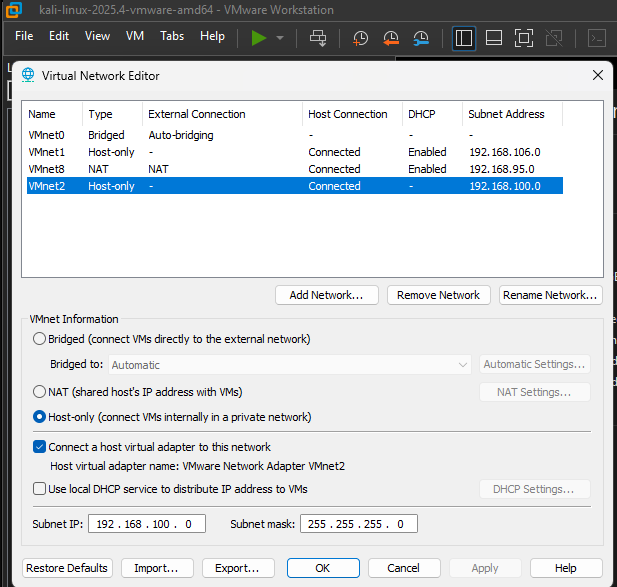

# Elastic SIEM Lab

I built this lab to learn Elastic Security hands-on. I have studied SIEM concepts during my cyber security bachelor and in the Google Cybersecurity Professional Certificate, but I had never worked with the Elastic before. The goal here is to get comfortable with how Elastic does it: how logs get from a host into Elasticsearch, how Fleet manages the agents, and how detection rules are written and tested in Kibana. Everything runs inside VMware.

The setup is small: one Elastic Stack server, one Linux host that gets monitored, one Kali VM that attacks it, and the detection rules I write to catch those attacks.

This repository documents what I did, why I did it, and what went wrong along the way. I kept the commands and the screenshots so the results can be checked.

## Why I built it

I wanted hands-on experience with Elastic Security, because many job postings name it and reading the documentation is not the same as running the stack. I also wanted to see how a log gets from a host into Elasticsearch, and why a detection can fail even when the rule looks correct in Kibana. Network segmentation came later, as a second track. I wanted Elastic working before I started changing firewall rules, so I would know which part caused a problem.

## Tools and versions

- Windows host running VMware Workstation Pro.
- Ubuntu Server 24.04 LTS for the Elastic server and the monitored host.
- Kali Linux VM as the attacker.
- Elastic Stack 9.5.3 (Elasticsearch, Kibana, Fleet Server, Elastic Agent), the version that was current when I started.

The host has 100 GB of RAM, which is far more than this lab needs. The VM sizes below are what I chose, not the minimum. I have not tried smaller sizes, so I cannot say how low they can go.

## Terms used in this README

**SIEM (Security Information and Event Management):** a system that collects logs from many machines, stores them in one place, and runs rules that flag suspicious activity.

**Elasticsearch:** the search and storage engine that holds the logs.

**Kibana:** the web interface where I search logs, view dashboards, and manage detection rules.

**Fleet Server:** the component that manages Elastic Agents from one central place.

**Elastic Agent:** a small program installed on each monitored host. It collects logs and sends them to Elasticsearch through Fleet.

**Integration:** a ready-made package that tells the agent which logs to collect and how to read them.

**Data stream:** how Elasticsearch stores time-based logs, so they can be searched and kept according to a retention policy.

**Detection rule:** a condition that runs over incoming events and creates an alert when it matches.

**ECS (Elastic Common Schema):** the standard field names Elastic uses, for example `source.ip` or `user.name`. Rules are easier to write when every log source uses the same names.

**MITRE ATT&CK:** a public catalogue of attacker techniques. Each detection in this lab is linked to one or more of them.

## Lab design

### Why two tracks

The first track is the SIEM on a flat network. I wanted the SIEM to work before I added firewall rules, so that a broken log pipeline could only be caused by the SIEM setup. The second track is segmentation, which I added after logs were already flowing. That way each firewall rule could be tested against real data.

### Track 1: flat lab network

| VM | IP on lab-net | RAM | vCPU | Disk | Role |
|---|---|---|---|---|---|
| Windows host | 192.168.100.1 | (host) | (host) | (host) | Browser for Kibana, SSH client to make my life easyer |
| `elk-siem-node` | 192.168.100.10 | 16 GB | 4 | 80 GB | Elasticsearch, Kibana, Fleet Server |
| `target-node` | 192.168.100.20 | 4 GB | 2 | 30 GB | Monitored host, DVWA in Docker, Elastic Agent |
| `kali` | 192.168.100.30 | 8 GB | 2 | existing | Attacker |

All lab VMs sit on one host-only network called `lab-net`, `192.168.100.0/24`. The Windows host has `.1` on this network, so I can open Kibana in the browser and SSH into each VM from PowerShell or VS Code without switching windows. Keeping the lab reachable from the host was a practical choice for working faster, not a security decision.

Each VM also has a second adapter on NAT. I use it only for package updates. Attack traffic never goes through it, so it does not change what the lab tests.

### Track 2: segmentation (chapter 11)

Companies rarely run everything on one network, and firewall logs are among the most useful sources a security team has. In this track I add a fourth VM, `fw-node`, as a router and firewall running nftables. It splits the lab into four zones with default deny between them, and its logs go to the same SIEM.

| Zone | Network | Hosts |
|---|---|---|
| mgmt | 10.10.10.0/24 | Windows host, fw-node |
| attack | 10.10.20.0/24 | kali |
| dmz | 10.10.30.0/24 | target-node |
| security | 10.10.40.0/24 | elk-siem-node |

The rules I plan to allow are these. The Windows host reaches every zone over SSH, and Kibana in the security zone. The attack zone reaches the dmz zone, since that is where the attacks land. The dmz zone reaches Fleet and Elasticsearch in the security zone, on those ports only, because agents start the connection. The attack zone has no path to the security zone. I want to confirm that with a test from Kali, not just assume it.

## Phases

- [ ] Phase 0: Design
- [ ] Phase 1: Virtual machines and flat network
- [ ] Phase 2: Base hardening
- [ ] Phase 3: Elasticsearch and Kibana
- [ ] Phase 4: Fleet Server and Elastic Agent
- [ ] Phase 5: Baseline data collection
- [ ] Phase 6: DVWA target
- [ ] Phase 7: Attack simulation from Kali
- [ ] Phase 8: Detection rules, tested against the attacks
- [ ] Phase 9: Dashboard and alerting
- [ ] Phase 10: Summary and lessons learned
- [ ] Phase 11: Segmentation with fw-node

## Implementation log

Each phase below follows the same pattern. First what I did, then why, then the commands, then the output I got, and last the problems I ran into and how I solved them. Screenshots only appear where they show something I want to prove.


### Phase 1: Virtual machines and flat network

**What I did:** Created a host-only network (VMnet2) called lab-net with DHCP turned off. Installed `target-node` on Ubuntu Server 24.04 LTS. Gave `elk-siem-node`, `target-node` and `kali` a second adapter on NAT for package updates. Set static addresses with netplan on the two Ubuntu VMs and with NetworkManager on Kali. Checked connectivity from Kali, from the ELK node and from the Windows host.

**Why I chose Ubuntu Server 24.04:** The Elastic support matrix for 9.5.3 lists Ubuntu 24.04 as a supported platform (screenshot below). It is the current LTS release, with standard support until 2029, and it is the same OS as the PHP lab, so I only have to keep one set of commands in my head.

**Why static addresses:** I wanted addresses I could write in this README and use in firewall rules later. Turning off DHCP made that predictable. I stopped cloud-init from rewriting the network config, because otherwise the addresses would change after a reboot.

**Why a NAT adapter as well:** The NAT adapter is only for package downloads, so the VMs can reach the Ubuntu and Elastic repositories. Lab traffic uses the lab-net route, and Kali has `never-default` on lab-net, so attack traffic cannot leave through NAT by accident.

**Commands:** `ip -br a`, `ip route`, `netplan try`, `nmcli con add`, `ping`, `curl`, `reboot` (persistence test).

**Output from `ip route` on elk-siem-node:**

```
[paste output]
```

**Problems I hit:** `[what did not work the first time, and what fixed it]`





The log is filled in as each phase is finished. Phase 1 is next.
